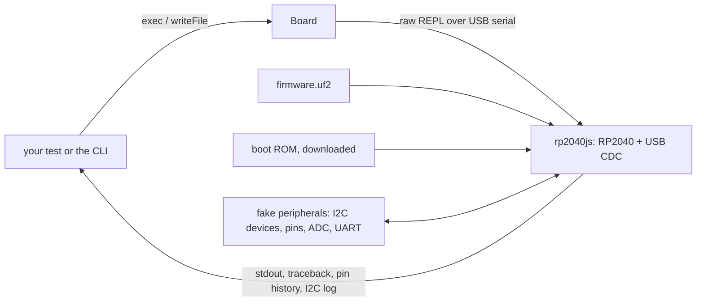

# pico-emu-test

Boot a MicroPython firmware for the Raspberry Pi Pico on your PC, talk to it over its serial console,
fake the chips and signals around it, and run automatic tests on it, with no board and no cable.

```sh
node bin/pico-emu-test.js pico --exec "print(1 + 1)"
```

```text
2
```

## Why

A firmware that does not boot, or that boots into an exception, is a problem when the only way to fix
it is a USB cable. It is worse when the board is already installed somewhere and you just pushed an
update to it over the air: a bad image can leave it unreachable.

`pico-emu-test` runs the very `.uf2` file you are about to ship inside the [`rp2040js`][rp2040js]
emulator, on any PC with Node.js. It starts the firmware, waits for the MicroPython prompt, runs
Python on it through the same serial console a human would use, and reports the result with an exit
code that CI understands. You can plug fake peripherals into it (an I2C sensor, a button, a UART), so a
driver can be tested against a model of the device before it meets the real one.

It checks that firmware **starts and behaves**. It does not replace testing on a board: see
[What is emulated](#what-is-emulated-and-what-is-not).

## What it does

- Loads any RP2040 `.uf2` image: the official MicroPython builds, or your own build with C modules.
- Waits for the prompt and runs Python code or whole scripts, returning stdout, the traceback, and the
  emulated time spent.
- Copies files into a filesystem on the board (RAM disk), or preloads a prebuilt LittleFS image.
- Fake peripherals: programmable I2C devices (hardware and software I2C), GPIO pins you can drive and
  whose history is recorded (the LED, PWM outputs...), ADC inputs, UARTs.
- A command line tool with exit codes for CI, a Node API for tests, and a small Python launcher for
  pytest.
- Downloads the official MicroPython image and the RP2040 boot ROM itself, checking pinned SHA-256
  digests. No third-party binary is stored in this repository.

## Quick start

You need Node.js 22 or newer.

```sh
git clone https://github.com/AstroQuestStudio/pico-emu-test.git
cd pico-emu-test
npm install
```

Run some Python on the official MicroPython firmware (the first run downloads about 3 MB into a cache
directory; see [Downloads and cache](#downloads-and-cache)):

```sh
node bin/pico-emu-test.js pico --exec "import os; print(os.uname().machine)"
node bin/pico-emu-test.js pico --exec "x = 6" --exec "print(x * 7)" --expect 42
node bin/pico-emu-test.js ./my-firmware.uf2 --script tests/smoke.py --timeout 60000
echo $?    # 0 when it passed
```

Used from another project, install it from the repository and call it with `npx`:

```sh
npm install --save-dev github:AstroQuestStudio/pico-emu-test
npx pico-emu-test firmware.uf2 --exec "print(1+1)"
```

### A test in JavaScript

`node --test` is enough; no framework needed.

```js
import assert from 'node:assert/strict';
import { after, before, test } from 'node:test';
import { Board, RegisterSlave } from 'pico-emu-test';

let board;
before(async () => {
  board = await Board.boot({ firmware: 'firmware.uf2' });   // or fetchOfficialFirmware('pico')
});
after(() => board.stop());

test('the driver reads the temperature register', async () => {
  const sensor = board.i2c(0).attach(new RegisterSlave({ address: 0x48, registers: { 0x00: 0x19 } }));
  await board.writeFile('/driver.py', 'def read(i2c):\n    return i2c.readfrom_mem(0x48, 0, 1)[0]\n');
  const value = await board.exec(
    'from machine import I2C, Pin\nimport driver\n' +
    'print(driver.read(I2C(0, sda=Pin(4), scl=Pin(5))))');
  assert.equal(value.trim(), '25');
  assert.deepEqual(sensor.log.map((e) => e.type), ['read']);
});
```

Worked examples that run in CI are in [`examples/`](examples): the basics (`hello.test.js`), a sensor
driver tested against a fake MPU-6050 (`mpu6050.test.js`, with the fake in `devices/mpu6050.js`), and
a button and LED with debouncing (`button-led.test.js`).

### A test from Python (pytest)

```python
from pico_emu_test import run

def test_boots_and_computes():
    result = run("firmware.uf2", exec="print(6 * 7)")
    assert result.ok and result.stdout == "42\n"
```

`python/pico_emu_test.py` is a single file around the command line tool (each call boots a fresh
board). See [`examples/pytest`](examples/pytest) and [`python/README.md`](python/README.md).

## How it works



`Board` creates an `rp2040js` simulator, loads the boot ROM and the UF2 image, and starts it. The
firmware enumerates as a USB serial device; `Board` plays the host. Each `exec` interrupts whatever is
running, enters MicroPython's raw REPL, sends the code, and parses the reply (output, then traceback).
Peripherals are JavaScript objects wired to the emulated I2C controllers, GPIO pads, ADC and UARTs.

Time is the emulated clock (125 MHz, counted per instruction), not the wall clock. Anything that waits
(`time.sleep`) costs wall time too, because the emulator is slower than a real board
([measured below](#speed)).

## API

Everything is exported from `pico-emu-test`. The source is documented with JSDoc.

### `Board`

```js
const board = await Board.boot({ firmware, ...options });   // create, start, wait for the prompt
const board = await Board.create({ firmware, ...options }); // create only: attach peripherals first
await board.start();
```

| Option | Meaning |
|---|---|
| `firmware` | Path of a `.uf2` file, or its bytes. Required. |
| `bootrom` | Boot ROM: `Uint32Array`, or path of a `.elf` / 16 KiB `.bin`. Default: the official B1 ROM, downloaded once. |
| `flashImage`, `flashImageOffset` | Raw bytes copied into flash after the UF2 (a LittleFS filesystem for instance). Offset defaults to `0xa0000`. |
| `i2cTiming` | `true` (default): hardware I2C transactions take the time they would on a real bus. |
| `bootTimeoutMs` | Wall-clock limit to reach the prompt (`Board.boot` only, default 20000). |
| `verbose` | Print emulator warnings on stderr. |
| `log` | Receives progress messages (downloads). |

| Member | What it does |
|---|---|
| `exec(code, {timeoutMs})` | Run Python, resolve with what it printed (line ends as `\n`). Throws `PythonError` (with `stderr`, `stdout`) on an exception, `TimeoutError` after `timeoutMs` of wall time (default 30000), `EmulationError` if the firmware needs something not emulated. Calls are queued, never interleaved. |
| `run(code, {timeoutMs})` | Same, but resolves with `{ok, stdout, stderr, timeMs}` instead of throwing on a Python exception. |
| `evalJson(expression)` | Evaluate a Python expression and return it as a JavaScript value (uses `json` on the board). |
| `writeFile(path, data)`, `readFile(path)`, `listDir(path)` | Files on the board. `writeFile` mounts a RAM filesystem as `/` on first use and creates parent directories. `mountRamFs({sizeKb})` does it explicitly. |
| `pin(n)` | GPIO `n` (0 to 29), see `Pin`. `board.led` is GP25. |
| `i2c(0 \| 1, {sda, scl})` | One of the two I2C controllers, see `I2CBus`. |
| `uart(0 \| 1)` | One of the two UARTs, see `Uart`. |
| `setAdc(channel, {volts \| raw})` | Set what ADC channel 0 to 3 (GP26 to GP29) or 4 (temperature sensor) reads. |
| `sleep(ms)` | Let `ms` of emulated time pass without running Python. Resolves at that exact emulated instant. |
| `timeMs` | Emulated time since power-on. |
| `serialLog`, `onSerial(fn)`, `write(data)` | Raw serial console: everything printed so far, a subscription, and a way to type into it. |
| `interrupt()` | Send Ctrl-C twice. |
| `stop()` | Stop the emulation. Always call it (use `after`/`finally`). |
| `mcu` | The underlying `rp2040js` `RP2040` object, for anything not covered here. |

### `Pin`

| Member | What it does |
|---|---|
| `level` | What the firmware drives: `true`, `false`, or `null` if the pin is not an output. |
| `state` | `'high'`, `'low'` (driven), or `'input'`, `'input-pullup'`, `'input-pulldown'`, `'input-bus-keeper'`. |
| `drive(level)` | Apply a level from outside, like a button or another chip. |
| `release()` | Stop driving: reads high if the firmware enabled the pull-up, low otherwise. |
| `history` | Every change of the driven level: `{timeMs, level}`. All pins are recorded from power-on (capped at 100000 events per pin). |
| `clearHistory()` | Empty it. |
| `waitFor(level, {timeoutMs})` | Resolve when the firmware drives the pin to `level`. |
| `measure({sinceMs})` | `{edges, frequencyHz, dutyCycle}` estimated from the history, for PWM or a blinking LED. |

### Fake I2C devices

`board.i2c(0).attach(device)` connects a device; `detach(address)` removes it; `bus.stats` counts
transactions, bytes and NACKs. Setting `device.enabled = false` makes it vanish from the bus (NACK).

`RegisterSlave` is a device with 256 byte registers and the usual "register pointer, then data"
protocol, including repeated-start reads and auto-increment:

```js
const device = new RegisterSlave({
  address: 0x68,
  registers: { 0x75: 0x68 },        // initial values
  readOnly: [0x75],                 // writes are acknowledged but ignored
  autoIncrement: true,              // default
  onRead: (register, device) => undefined,   // return a number to override what is read
  onWrite: (register, value, device) => {},
});
device.get(reg);  device.set(reg, byteOrBytes);  device.setInt16(reg, value, {littleEndian});
device.writesTo(reg);   // values the firmware wrote there
device.log;             // every access: {type: 'read' | 'write', register, value}
```

For another protocol, extend `I2CSlave` and implement `start(mode)`, `write(byte) -> boolean (ACK)`,
`read() -> byte`, `stop()`. [`examples/devices/mpu6050.js`](examples/devices/mpu6050.js) models a real
sensor (WHO_AM_I, sleep bit, full-scale ranges, 14-byte burst read).

Hardware I2C and `machine.SoftI2C` both work. MicroPython scans the bus and drives software I2C by
wiggling the pins itself, so the bus decodes the six pin pairs each controller can use, plus the
`{sda, scl}` pair you pass. The bus lines read high (pull-ups), as on a real bus.

### `Uart`

`sent` / `sentText`: bytes the firmware transmitted. `feed(data)`: send bytes to the firmware's receive
pin, paced at the baud rate it configured. `clearSent()`.

### Downloads and cache

`fetchOfficialFirmware('pico' | 'pico-w')` returns the path of the official MicroPython 1.29.0 image,
downloading and verifying it on first use. `ensureAsset`, `cacheDir`, `OFFICIAL_FIRMWARE`, `BOOTROM_B1`
are exported too. Files go to `%LOCALAPPDATA%\pico-emu-test` on Windows and `~/.cache/pico-emu-test`
elsewhere. Environment variables:

| Variable | Effect |
|---|---|
| `PICO_EMU_CACHE_DIR` | Use another cache directory. |
| `PICO_EMU_BOOTROM` | Path of a boot ROM to use instead of downloading one. |
| `PICO_EMU_OFFLINE=1` | Never download; fail with a message if a file is missing from the cache. |
| `PICO_FIRMWARE` | Firmware used by this repository's own tests and examples instead of the official one. |
| `PICO_TEST_LFS_IMAGE` | Enables the LittleFS preload test (CI builds the image, see below). |

`npm run fetch` (or `pico-emu-test fetch`) downloads everything ahead of time.

## Command line

```text
pico-emu-test <firmware> [options]        firmware: a .uf2 file, or "pico" / "pico-w"
pico-emu-test fetch [pico|pico-w|bootrom]

  -e, --exec <code>        Python to run (repeatable)
  -s, --script <file.py>   Python file to run (repeatable; --exec and --script run in the order typed)
  -p, --put <local[=remote]>   copy a file to the board first (repeatable)
      --expect <text>      exit 4 unless the output contains this (repeatable)
  -t, --timeout <ms>       wall-clock limit per step (default 30000)
      --boot-timeout <ms>  wall-clock limit to reach the prompt (default 20000)
      --bootrom <file>     boot ROM to use
      --flash-image <file> [--flash-offset <n>]   preload an image into flash
  -i, --interactive        afterwards, attach the terminal to the console (Ctrl-X quits)
      --json               one JSON report on stdout
  -q, --quiet   -v, --verbose
```

| Exit code | Meaning |
|---|---|
| 0 | Everything ran and every `--expect` matched. |
| 1 | A Python exception on the board. The traceback is on stderr. |
| 2 | The firmware did not reach the MicroPython prompt. |
| 3 | A step exceeded its time limit. |
| 4 | An `--expect` text was not found. |
| 5 | The firmware needed something the emulator does not have (for example the second core). |
| 64 | Usage error. |

## What is emulated, and what is not

Everything in this table comes from a test in this repository or from `scripts/bench.mjs`, run with the
official MicroPython v1.29.0 images (`RPI_PICO` and `RPI_PICO_W`, 2026-08-24) on `rp2040js` 1.4.2.
"Tested" names the test file. Nothing was compared with a real board here: no board was available.

| Part | Status | Detail |
|---|---|---|
| Boot, REPL over USB serial | Works | Boots to the prompt in about 27 ms of emulated time. Pico and Pico W images (`board.test.js`, `limits.test.js`). |
| CPU core 0, interrupts, timers | Works | `time.sleep_ms(100)` measured 99.2 to 99.6 ms by the firmware's own `ticks_us()` (three runs, Pico and Pico W). A 10 ms periodic `Timer` fired 10 times in 105 ms (`peripherals.test.js`, `scripts/bench.mjs`). |
| **Second core** (`_thread`, multicore FIFO) | **Not emulated** | Core 1 does not exist. The emulator detects the firmware waiting for it and fails the call with `EmulationError` (exit code 5) instead of hanging (`limits.test.js`). A firmware that needs two cores cannot be tested here. |
| **Flash writes and erases** | **Not emulated** | `rp2.Flash().writeblocks()` returns without error and the data is not stored; the sectors stay erased (`limits.test.js`). `open(..., 'w')` on the preloaded LittleFS image fails with an `OSError`. Reading works. Anything that persists settings to flash cannot be tested; use `writeFile` (RAM disk) instead. |
| Filesystem | Workaround | With nothing in flash the root filesystem is empty and unwritable (`ENODEV`). `writeFile` mounts a 64 KiB FAT RAM disk as `/` (taken from the board's heap) and `main.py`/modules can then be imported. A prebuilt LittleFS image preloaded with `flashImage` is readable and its `main.py` runs at boot; checked for the Pico (offset `0xA0000`) and the Pico W (offset `0x12C000`, 212 blocks) (`files.test.js`, `examples/make_lfs_image.py`). |
| GPIO inputs, outputs, interrupts | Works | Drive a pin, read the output history, IRQs on edges (`pins.test.js`). A pin the firmware drives reads back its own level (patched, see below). |
| PWM output | Works | 1 kHz at 25 % measured as 1000.00 Hz and 0.25 (`pins.test.js`). PWM input and counting modes were not tested. |
| ADC | Works | Channels 0 to 4 return the value set with `setAdc`: no noise, 12-bit codes (`peripherals.test.js`). Free-running mode and DMA not tested. |
| UART | Works | Capture transmitted bytes, feed received ones, `readline()` (after a patch, see below). Transmission is instantaneous: it takes no emulated time. |
| I2C controller (master) | Works | Hardware and software I2C, scan, register reads and writes, NACK on a missing device (`i2c.test.js`). Hardware transactions are timed from the controller's clock registers: A 6-byte `readfrom_mem` at 400 kHz measured 280 us from Python, interpreter overhead included. The project this was extracted from reported 902 us emulated against 878 us on a real board for one other access pattern; that was not re-measured here. Acting as an I2C target (slave) was not tested. |
| SPI | Partly | The controller runs and `write`/`read` complete, but there is no device API: reads return zeros (a probe, not part of the test suite). |
| PIO | Partly | Programs run and drive pins (a blink program toggled GP6), but rp2040js steps PIO on host timers, not on the emulated clock. In my test a state machine configured for 2 kHz produced about 4000 transitions at the same emulated instant instead of a slow blink. Do not use PIO timing in tests. |
| **Pico W radio (CYW43: Wi-Fi, Bluetooth, the LED)** | **Not emulated** | The Pico W image boots and the REPL works, but `network.WLAN(...).active(True)` prints `[CYW43] Failed to start CYW43` and returns, and `Pin('LED')` had not returned after 6 s in a probe. Test Wi-Fi code on a board. |
| `machine.reset()`, `machine.soft_reset()` | Not supported | The board ends up asleep; the call fails with `EmulationError`. To restart, boot a new `Board` (about 0.2 s). |
| RTC, watchdog | Barely | `machine.RTC().datetime()` answers and `WDT.feed()` is accepted; neither was tested further. A watchdog expiry does not reset the board. |
| USB | Console only | Only the CDC serial console exists. Other USB device classes are not available. |
| RP2350 (Pico 2) | Not supported | `rp2040js` emulates the RP2040 only. |
| CPU-bound timing | Do not trust | `for i in range(N): pass` cost about 14 us of emulated time per iteration in my measurement (see Speed). I could not compare this with a board, so treat the emulated duration of pure Python computation as unverified. Peripheral timing (I2C, PWM, timers) is tied to the clock and behaves as in the table above. |

### Differences from rp2040js 1.4.2

`src/patches.js` corrects three behaviours at run time, without modifying `node_modules`:

1. A pin driven as an output reads back its own level (rp2040js returned the externally applied level,
   so `led.value()` read 0 after `led.value(1)`).
2. The UART transmit interrupt can be cleared. rp2040js re-asserted it after every register access, and
   MicroPython's `UART(...)` constructor then spun in its interrupt handler for ever.
3. The inter-core FIFO answers "ready, empty" instead of printing a warning on every access (tens of megabytes
   of console output within seconds), and a write to it is reported as an `EmulationError`. A firmware
   that sleeps waiting for another core is detected after about half a second of wall time.

### Speed

Measured with `node scripts/bench.mjs` on a Windows 11 laptop (8-core AMD Ryzen 7, Node.js 26.13), two
runs about an hour apart:

| What | Emulated | Wall clock | Ratio |
|---|---|---|---|
| Boot to the prompt | 27 ms | 180 to 370 ms | 0.07 to 0.15 |
| `exec` of an empty program | 28 ms | 125 to 230 ms | 0.12 to 0.22 |
| `time.sleep(1)` | 1029 ms | 5.6 to 9.0 s | 0.11 to 0.18 |
| 100000 iterations of an empty `for` loop | 1420 ms | 7.9 to 14.5 s | 0.10 to 0.18 |
| Copy 8 KiB to the board (`writeFile`) | | about 5 s | |

So the emulator runs at roughly **a tenth to a fifth of real time**, and a test that sleeps for a
second costs five to nine. The firmware's idle loop busy-polls instead of sleeping (about 14 million
instructions executed in 200 ms of idle REPL), so waiting is not free. Keep sleeps short, use
`board.sleep(ms)` when you only need time to pass, and prefer small files. Each `exec` also pays the
raw REPL entry, about 100 to 230 ms.

### What was verified, and how

On Windows 11, with Node.js 26.13 and again with Node.js 22.23:

```sh
npm test               # library and CLI tests (56 tests; the LittleFS test needs PICO_TEST_LFS_IMAGE)
npm run examples       # 10 example tests
python -m pytest examples/pytest     # 6 tests, pytest 9
```

The GitHub Actions workflow in `.github/workflows/ci.yml` (Ubuntu, Node.js 22) does the same and
builds the LittleFS image with `littlefs-python`. **It has not run yet**: it was written and its steps
were run by hand on Windows, but no Linux runner was available. Only the official MicroPython 1.29.0
images were tested. The project this was extracted from also booted a custom firmware with a C module
the same way; that firmware is not part of these tests.

## Limits and risks

- A pass here means the firmware starts and the code under test behaved against a model. It does not
  mean the board will behave. Pin electrical behaviour, real timing, power, radio and flash wear are
  not modelled.
- The fake devices are only as good as your model of the chip.
- Tests that depend on `time.sleep` are slow; tests that depend on CPU speed are not meaningful.
- The first run needs network access (about 3 MB), unless you provide the boot ROM and firmware yourself.
- The emulator is `rp2040js` 1.4.2, pinned. Upgrading may change the limits above:
  `test/limits.test.js` is there to notice.

## Troubleshooting

| Symptom | Cause and fix |
|---|---|
| `Download of ... failed` or `PICO_EMU_OFFLINE` message | No network. Set `PICO_EMU_BOOTROM` and pass your own `.uf2`, or copy the files into the cache directory (`pico-emu-test fetch` shows its location when it works). |
| `The firmware did not reach the MicroPython prompt` | Not a MicroPython image for the RP2040, or it crashes at start. The message includes the last serial output. A boot that needs the second core or the radio will not get there. |
| `TimeoutError` on `exec` | The code did not finish within `timeoutMs` of wall time, probably because it sleeps or computes for long. Raise the limit, shorten the work, or `board.sleep()`. |
| `EmulationError` | The firmware needs the second core, a reset, or similar. See the table. |
| `OSError: [Errno 19] ENODEV` on `open(..., 'w')` | The board has no mounted filesystem. Use `board.writeFile()` first, or `board.mountRamFs()`. |
| `MemoryError` after copying files | The RAM disk is allocated from the board's heap (64 KiB by default); pass a smaller `sizeKb` to `mountRamFs`. |
| The process does not exit | Call `board.stop()`. |

## En français

`pico-emu-test` démarre sur PC, sans carte, un firmware MicroPython pour Raspberry Pi Pico (un fichier
`.uf2`, officiel ou personnalisé) dans l'émulateur `rp2040js`. On lui envoie du Python par la console
série émulée, on branche de faux périphériques (esclave I2C programmable, broches, ADC, UART) et on écrit
des essais automatiques qui tournent en intégration continue. C'est un garde-fou : vérifier qu'un firmware
démarre et répond avant de l'envoyer à une carte, surtout par radio, où une mauvaise image peut la rendre
injoignable. Démarrage rapide : `npm install`, puis `node bin/pico-emu-test.js pico --exec "print(1+1)"`
(le code de retour dit si l'essai a réussi). Limites mesurées : pas de second cœur, pas d'écriture en
flash, pas de radio de la Pico W, PIO non synchronisé sur l'horloge, et un émulateur environ cinq à dix
fois plus lent que le temps réel. Le tableau détaillé est plus haut, en anglais.

## Credits and licence

Built on [`rp2040js`][rp2040js] by Uri Shaked (Wokwi), MIT licence, which does all the hard work of
emulating the RP2040. The RP2040 boot ROM comes from Raspberry Pi's
[`pico-bootrom-rp2040`](https://github.com/raspberrypi/pico-bootrom-rp2040) and the test firmware is
the official [MicroPython](https://micropython.org/) build (MIT); both are downloaded, not distributed
here, for the reasons given in [`NOTICE.md`](NOTICE.md). This project is not affiliated with any of
them.

MIT licence, Copyright (c) 2026 AstroQuestStudio. See [`LICENSE`](LICENSE).

[rp2040js]: https://github.com/wokwi/rp2040js
